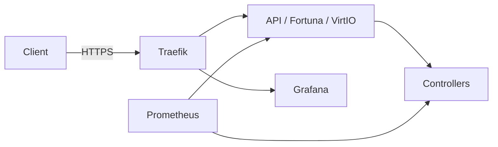

# LoKey: True Random Number Generation Service

[](https://github.com/LokeyTRaaS/Lokey/actions/workflows/build.yml)
[](https://github.com/LokeyTRaaS/Lokey/actions/workflows/linter.yml)
[](https://github.com/LokeyTRaaS/Lokey/actions/workflows/release.yml)
[](https://lokeytraas.github.io/Lokey/api-reference.html)
[](https://opensource.org/licenses/MIT)

<div align="center">
  
</div>

**Hardware-based true random number generation for Raspberry Pi 5 (ARM64) and x86_64**

ATECC608A TRNG + Fortuna CSPRNG + VirtIO entropy delivery, fronted by Traefik (HTTPS), with Prometheus/Grafana observability. Local development uses an emulated controller (no chip required).

## Choose a deploy path

| Path | Best for | Reproducibility |
|------|----------|-----------------|
| **NixOS SD image** (recommended for Pi) | Flash-and-boot Raspberry Pi 5 appliance | Highest — pinned flake lock |
| **Containers (Compose / GHCR)** | Laptops, servers, quick bring-up | High — image digests on GHCR |
| **Release binaries** | Bare metal / custom init | Medium — static Go builds per arch |

### 1. NixOS (most reproducible)

Build a flashable microSD image for Raspberry Pi 5 from the flake (CI only *validates* the flake; it does not build the image):

```bash
# Needs Nix + flakes; aarch64 host or qemu-aarch64 binfmt
nix build .#packages.aarch64-linux.sdcard
./scripts/flash-sd.sh /dev/sdX          # confirms before dd
```

Default SSH user after flash: `lokey` / `lokey` (change immediately). Controllers start in **emulated** mode so first boot works without ATECC wiring.

Full options, TLS, and multi-device setup: **[docs/nixos.md](docs/nixos.md)**.

### 2. Containers

From a [GitHub Release](https://github.com/LokeyTRaaS/Lokey/releases) (multi-arch manifests on GHCR; versions are cut automatically from conventional commits on `main` — see [docs/releasing.md](docs/releasing.md)):

```bash
export VER=1.2.0   # pin a release; or use latest
docker pull ghcr.io/lokeytraas/lokey/api:${VER}
docker pull ghcr.io/lokeytraas/lokey/controller:${VER}
docker pull ghcr.io/lokeytraas/lokey/fortuna:${VER}
docker pull ghcr.io/lokeytraas/lokey/virtio:${VER}
```

Or build/run the full stack locally (emulator by default):

```bash
git clone https://github.com/LokeyTRaaS/Lokey.git
cd Lokey
mkdir -p run/lokey
docker compose up -d --build
curl -k https://localhost/api/v1/health
```

### 3. Binaries

Download per-service archives from the [GitHub Releases](https://github.com/LokeyTRaaS/Lokey/releases) page, e.g. `lokey-api-arm64.tar.gz`, `lokey-controller-amd64.tar.gz`. There is one archive per service × architecture — no combined mega-tarball.

```bash
tar -xzf lokey-api-arm64.tar.gz
chmod +x lokey-api-arm64
./lokey-api-arm64
```

Wire services with the env vars documented in [docs/deployment.md](docs/deployment.md) (or use Compose).

## Quick Links

- **[Quickstart](docs/quickstart.md)** — full stack locally with emulator
- **[Hardware Setup](docs/hardware-setup.md)** — Pi 5 + ATECC608A
- **[Deployment](docs/deployment.md)** — production / Traefik HTTPS
- **[NixOS](docs/nixos.md)** — flake, SD image, I2C + cgroups
- **[Releasing](docs/releasing.md)** — semantic-release, `RELEASE_TOKEN`, GHCR pins
- **[API Reference](https://lokeytraas.github.io/Lokey/api-reference.html)**
- **[Architecture](docs/architecture.md)**

## What You Get

- True randomness from ATECC608A (or `CONTROLLER_MODE=emulated` for laptop/CI)
- Fortuna amplification with Prometheus amplification metrics
- VirtIO named pipe + HTTPS streaming via Traefik
- Multi-device controllers on an isolated `lokey-devices` network + seccomp profiles
- Platforms: **linux/amd64** and **linux/arm64** only

## Architecture



Networks: `lokey-edge` (Traefik), `lokey-app` (API/Fortuna/VirtIO), `lokey-devices` (controllers), `lokey-metrics`. Entropy path detail: [Architecture](docs/architecture.md#fortuna-end-to-end).

## Local checks (pre-commit)

Static checks mirror CI (golangci-lint, Nix flake validate, Grype). No tests, image builds, or container scans on commit:

```bash
pre-commit install
pre-commit run --all-files
```

Requires `golangci-lint` (v2.15+), `grype`, and `nix` with flakes. CI also runs Grype on every push/PR (`severity-cutoff: high`).

## Project Status

- Production-oriented Docker Compose + NixOS deploy path
- Multi-arch CI (amd64, arm64) including VirtIO
- Automatic semver on `main` via semantic-release (see [docs/releasing.md](docs/releasing.md))
- Nix flake is checked in CI; SD images are built locally from the flake
- Pi Zero 2 / ARMv7 are **unsupported** (insufficient for cgroups/namespaces + Compose)

## License

MIT License — see [LICENSE](LICENSE).
