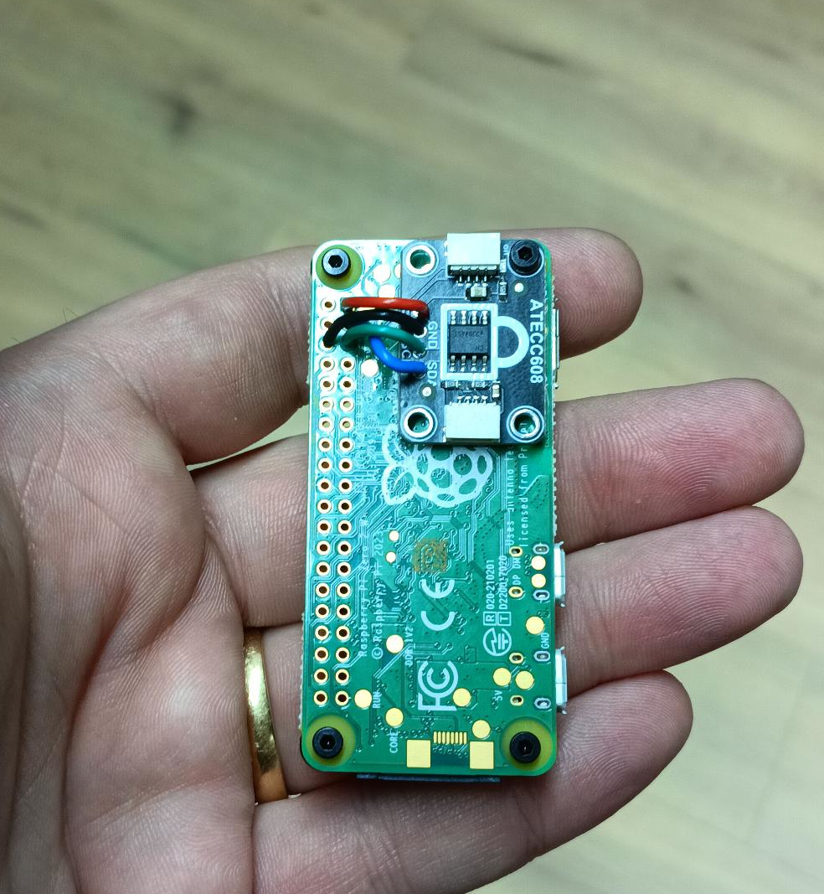

# Hardware Setup Guide

Complete guide for setting up **Raspberry Pi 5** (ARM64) with an ATECC608A cryptographic chip for LoKey.

> **Unsupported:** Raspberry Pi Zero 2 W and ARMv7 cannot sustain this stack with cgroups/namespaces and Docker Compose. For laptop testing without a chip, use `CONTROLLER_MODE=emulated` ([Quickstart](quickstart.md)). Prefer the [NixOS SD image](nixos.md) when you want a flash-and-boot appliance.

## Table of Contents

- [Overview](#overview)
- [Hardware Requirements](#hardware-requirements)
- [Hardware Connection](#hardware-connection)
- [OS Options](#os-options)
- [I2C and ATECC608A Configuration](#i2c-and-atecc608a-configuration)
- [Deploy LoKey Services](#deploy-lokey-services)
- [Troubleshooting](#troubleshooting)

## Overview

This guide walks through wiring an ATECC608A to a Raspberry Pi 5 and enabling I2C so LoKey controllers can harvest hardware TRNG data.

**Estimated time:** 1–2 hours  
**Difficulty:** Intermediate (soldering)

## Hardware Requirements

| Component               | Quantity | Purpose                    | Approximate Cost |
|-------------------------|----------|----------------------------|------------------|
| Raspberry Pi 5 (8GB+)   | 1        | Main host                  | €60–100          |
| Official Pi 5 PSU       | 1        | Stable 5V power            | €10–15           |
| ATECC608A chip/breakout | 1+       | Hardware TRNG source       | €2–5 each        |
| MicroSD card (16GB+)    | 1        | OS storage                 | €5–15            |
| Soldering equipment     | -        | Connecting ATECC608A       | -                |
| Wire (4 pieces / chip)  | -        | GPIO connections           | €1               |

For multi-device setups, add a second ATECC608A on another I2C bus or address and use Compose `controller-a` / `controller-b` (see [Deployment](deployment.md)).

## Hardware Connection

### ATECC608A Wiring

**Safety:** Power off and disconnect the Raspberry Pi before soldering.

| ATECC608A Pin | Raspberry Pi GPIO Pin | Pi Pin Number | Function  |
|---------------|-----------------------|---------------|-----------|
| VCC           | 3.3V                  | Pin 1         | Power     |
| SDA           | GPIO 2 (SDA)          | Pin 3         | I2C Data  |
| SCL           | GPIO 3 (SCL)          | Pin 5         | I2C Clock |
| GND           | Ground                | Pin 6         | Ground    |



### Soldering checklist

1. Cut four ~5 cm wires; strip 2–3 mm insulation.
2. Tin ends; solder to VCC, SDA, SCL, GND on the breakout.
3. Solder to the Pi 5 GPIO header as in the table (Pin 1 is nearest the board corner with the square pad).
4. Inspect for bridges; continuity-check if unsure.

## OS Options

### Option A — NixOS SD image (recommended)

Most reproducible path. Build and flash from a Nix host:

```bash
nix build .#packages.aarch64-linux.sdcard -o result-sdcard
./scripts/flash-sd.sh /dev/sdX
```

See [NixOS](nixos.md) for first boot, TLS, and switching from emulated to hardware controllers.

### Option B — Raspberry Pi OS Lite (64-bit)

1. Flash **Raspberry Pi OS Lite (64-bit)** with [Raspberry Pi Imager](https://www.raspberrypi.com/software/).
2. Enable SSH in Imager (or create an empty `ssh` file on the boot partition).
3. Before first boot, ensure I2C is enabled. On modern images edit `/boot/firmware/config.txt` (older: `/boot/config.txt`):

```ini
dtparam=i2c_arm=on
dtparam=i2c_arm_baudrate=100000
arm_64bit=1
```

Reference snippets: [`docs/assets/config.txt`](assets/config.txt), [`docs/assets/cmdline.txt`](assets/cmdline.txt).  
USB gadget serial overlays in those files are **optional** (legacy); Pi 5 normally uses Ethernet/Wi‑Fi + SSH.

4. Boot, SSH in, then install Docker Engine and the Compose plugin per Docker’s Raspberry Pi docs.

## I2C and ATECC608A Configuration

```bash
# Load tools
sudo apt-get update && sudo apt-get install -y i2c-tools

# Confirm the bus
ls /dev/i2c-*

# Scan (ATECC608A typically appears at 0x60)
sudo i2cdetect -y 1
```

You should see a device at address `60`. If not:

- Recheck wiring and 3.3V (not 5V).
- Confirm `dtparam=i2c_arm=on` and reboot.
- Try another bus number if using a HAT/expander.

LoKey controller env (Compose / systemd):

| Variable         | Typical value | Notes                          |
|------------------|---------------|--------------------------------|
| `CONTROLLER_MODE`| `hardware`    | Use `emulated` without a chip  |
| `I2C_BUS_NUMBER` | `1`           | Match `/dev/i2c-N`             |

## Deploy LoKey Services

From a clone of this repo on the Pi (or pull GHCR images):

```bash
mkdir -p run/lokey
# Optional: copy .env.template → .env and set LOKEY_DOMAIN / passwords
docker compose up -d
curl -k https://localhost/api/v1/health
```

For hardware controllers on the Compose stack, use the `hardware` profile (see [Deployment](deployment.md) and [Quickstart](quickstart.md)). Controllers sit on the isolated `lokey-devices` network; only Traefik publishes host ports (HTTPS).

GHCR images:

```bash
export VER=1.1.0
docker pull ghcr.io/lokeytraas/lokey/api:${VER}
docker pull ghcr.io/lokeytraas/lokey/controller:${VER}
docker pull ghcr.io/lokeytraas/lokey/fortuna:${VER}
docker pull ghcr.io/lokeytraas/lokey/virtio:${VER}
```

## Troubleshooting

| Symptom                         | Check                                              |
|---------------------------------|----------------------------------------------------|
| `i2cdetect` empty               | Wiring, 3.3V, `config.txt`, reboot                 |
| Controller unhealthy            | `CONTROLLER_MODE`, bus number, chip address `0x60` |
| Compose OOM / cgroup errors     | Pi 5 with enough RAM; do not use Pi Zero           |
| HTTPS connection refused        | Traefik up; `curl -k https://localhost/...`        |
| VirtIO pipe errors              | `mkdir -p run/lokey` before `compose up`           |

## Next steps

- [Deployment](deployment.md) — Traefik TLS, multi-controller, observability  
- [NixOS](nixos.md) — flake module and SD image  
- [API Examples](api-examples.md) / [API Reference](https://lokeytraas.github.io/Lokey/api-reference.html)
